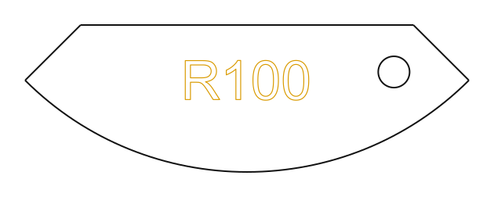

# RadiusTemplate Generator

Windows console tool that turns a radius into a **radius template (radius gauge) as a DXF file** for laser cutting.



*`RadiusMal.exe 100` — black: cut lines (outer contour and corner hole), yellow: engraving.*

The template has a convex radius arc, two 25 mm ears, a flat top, a corner hole and the engraving `R<radius>`. One file is written per radius: `RadiusTemplate_R<radius>.dxf`.

## Usage

Download `RadiusMal.exe` from [Releases](../../releases) (self-contained, no .NET needed), then:

```text
RadiusMal.exe 317.5
RadiusMal.exe 25 50 100 200 300 500 -o C:\Out
RadiusMal.exe 150 --angle 45 --text-height 10
```

Without arguments it asks for a radius. A decimal comma works too (`317,5`). See [Examples](Examples) for sample output.

| Option | Meaning |
|---|---|
| `-o, --out <folder>` | Output folder (default: current) |
| `-a, --angle <deg>` | Force arc angle. Default: R ≤ 100 → 90°, ≤ 200 → 60°, ≤ 300 → 45°, > 300 → 30° |
| `-e, --ear <mm>` | Ear length (default 25) |
| `--hole-dia <mm>` | Hole diameter (default 10) |
| `--hole-inset <mm>` | Hole centre to top/side edge (default 15) |
| `--text-height <mm>` | Engraving height (default 12.7) |
| `--text <text>` | Custom engraving text |
| `--no-text`, `--no-hole`, `--both-holes` | Omit text / hole, or hole in both corners |
| `--comma` | Decimal comma in the engraving (R317,5) |
| `--pause` | Wait for Enter when done |

Below R100 the ear, hole and text scale with `R / 100` so they stay inside the template.

## DXF output

R12 (AC1009), millimetres, accepted by AutoCAD and Inventor. The outer contour is 3 lines and one true arc; the engraving is short line segments (Arial outlines).

| Layer | Content |
|---|---|
| `DECOUPE_EXTERNE` | outer contour |
| `DECOUPE_INTERNE` | corner hole |
| `GRAVURE` | engraving text |

The French layer names are kept because laser software maps operations to them.

## Build

Requires the .NET 9 SDK. `dotnet run -c Release -- 317.5`, or `.\build.ps1` for the standalone `dist\RadiusMal.exe`.
